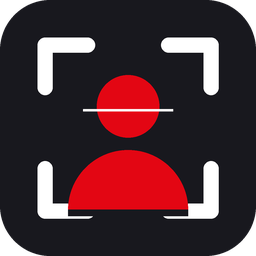
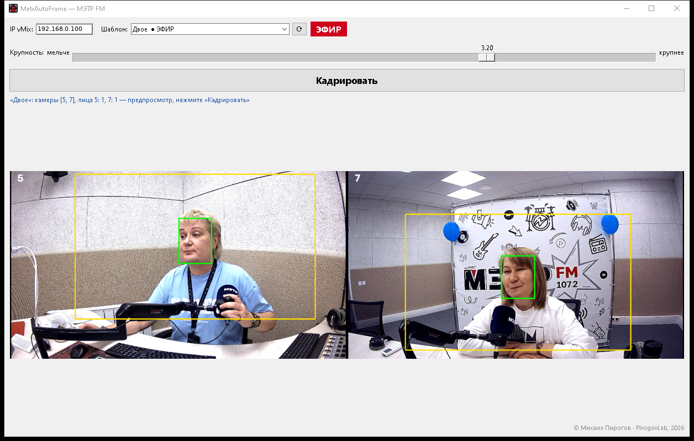
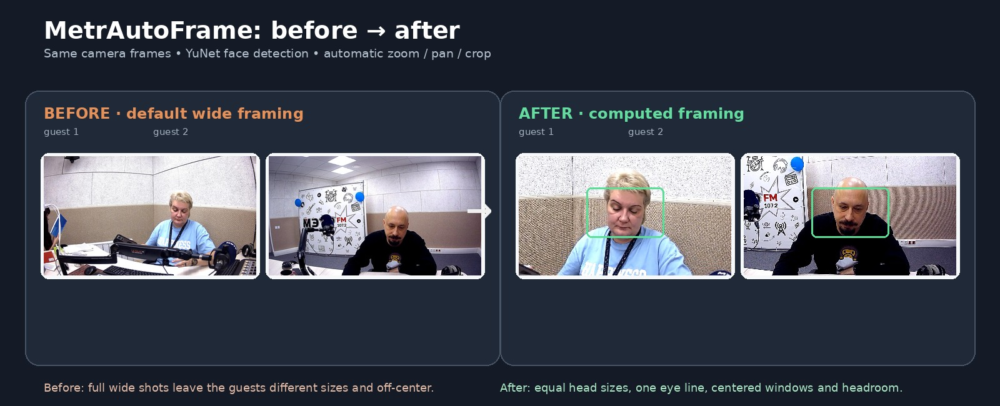
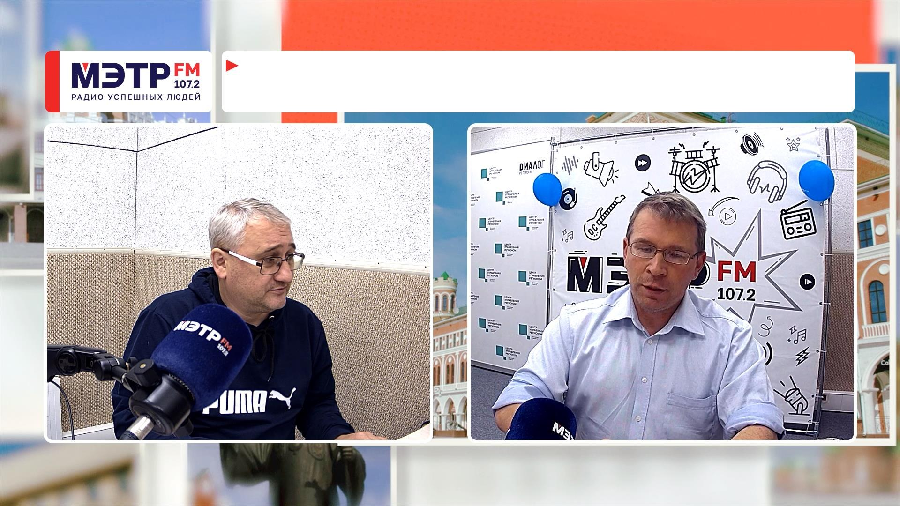

<p align="center"></p>

<h1 align="center">MetrAutoFrame</h1>
<p align="center"><b>Auto-framing of guests in vMix — one button, no PTZ cameras</b><br>
Автокадрирование гостей в vMix — одна кнопка, без PTZ-камер</p>

<p align="center">
<a href="https://github.com/MihailPirogov/metr-autoframe/releases/latest"></a>


</p>

<p align="center"></p>

[Русский](#русский) · [English](#english)

---

## Русский

Сделано для видеостудии радио **МЭТР FM**. В эфире на два–четыре гостя стоят обычные статичные камеры, а в vMix — шаблоны с окнами (картинка-рамка или видео-оформление). Гости садятся как удобно, и каждый раз кто-то крупнее, кто-то ниже, кто-то сбоку. MetrAutoFrame выравнивает их за пару секунд: **одна кнопка «Кадрировать»**.

### Что умеет
- **1–4 гостя** в одном шаблоне vMix; камеры — любые входы (NDI, SRT, VLC, Stream, capture).
- **Детектор лиц YuNet** (OpenCV) — быстро и без GPU.
- Подгоняет только **Zoom / PanX / PanY / Crop** слоёв-камер, чтобы головы были **одного размера, на одной линии глаз и по центру окон**. Preview/Program, цвет и другие входы не трогаются.
- **Окна берутся автоматически**: из прозрачных окон PNG-рамки или из альфа-канала видео-оформления (.mov через ffmpeg). Найденные окна кешируются в `окна.json` — на эфирной машине ни .mov, ни ffmpeg не нужны.
- Ползунок **«Крупность»** — мельче/крупнее, применяется сразу.
- **Отсчёт 3-2-1** перед кадрированием — гости успевают сесть ровно.
- Маркер **● ЭФИР** — видно, какой шаблон сейчас в программе.
- **Предупреждение о краях**: красная полоса в превью — с этой стороны камере не хватает картинки.
- Работает с локальным и удалённым vMix (кадры камер через DP Thumbnail Server).
- Список шаблонов — в простом `шаблоны.txt`, перечитывается на лету.

<p align="center"><br><i>Слева — исходные широкие планы: лица разного размера и не по центру. Справа — кадрирование MetrAutoFrame.</i></p>
<p align="center"><br><i>Шаблон с видео-оформлением: окна найдены по альфа-каналу</i></p>

### Установка и запуск
1. Скачайте `MetrAutoFrame.zip` из [Releases](https://github.com/MihailPirogov/metr-autoframe/releases/latest) и распакуйте. Установка не нужна.
2. В vMix включите **Settings → Web Controller** (порт 8088).
3. Для удалённого vMix поставьте на машину vMix **DP Thumbnail Server** (порт 8098) — через него берутся кадры камер.
4. Впишите свои шаблоны в `шаблоны.txt`:
   ```
   vMix = 192.168.0.100
   Двое в студии = 10
   Трое в студии = 15
   ```
5. Запустите `MetrAutoFrame.exe`, выберите шаблон и нажмите **«Кадрировать»**.

В шаблоне нужны слои-камеры и (желательно) картинка рамок с прозрачными окнами — имя входа содержит «шаблон», «рамк», «frame» или «okna». Либо видео-оформление с прозрачными «дырками».

### Сборка из исходников
```bat
python -m venv .venv
.venv\Scripts\pip install -r requirements.txt
.venv\Scripts\python get_model.py
.venv\Scripts\pyinstaller --noconfirm --onefile --windowed --name MetrAutoFrame ^
  --icon MetrAutoFrame.ico --version-file version.txt ^
  --add-data "config.json;." --add-data "face_detection_yunet_2023mar.onnx;." ^
  --add-data "MetrAutoFrame.ico;." app.py
```
Готовый exe — в `dist\`. Положите рядом `examples\шаблоны.txt` и `examples\окна.json`. Запуск без сборки: `python app.py`.

---

## English

Built for the **METR FM** radio video studio. Talk shows with two to four guests use plain static cameras, and vMix holds templates with windows (a PNG frame or an animated alpha overlay). Guests sit wherever they like, so one head ends up bigger, another lower, a third off-center. MetrAutoFrame lines them up in a couple of seconds with **one "Frame" button**.

### Features
- **1–4 guests** per vMix template; cameras can be any input (NDI, SRT, VLC, Stream, capture).
- **YuNet face detection** (OpenCV): fast, no GPU needed.
- Adjusts only **Zoom / PanX / PanY / Crop** of the camera layers so heads are **the same size, on one eye line and centered in their windows**. Preview/Program, color and other inputs are never touched.
- **Windows are found automatically** from the transparent holes of a PNG frame or from the alpha channel of a video overlay (.mov via ffmpeg). Results are cached in `окна.json`, so the on-air PC needs neither the .mov nor ffmpeg.
- **"Крупность" (shot size)** slider: tighter or wider, applied instantly.
- **3-2-1 countdown** before framing, so guests can settle.
- **● ЭФИР (ON AIR)** marker shows which template is in Program.
- **Edge warnings**: a red bar in the preview means the camera has no picture left on that side.
- Works with local and remote vMix (remote camera frames come from DP Thumbnail Server).
- Template list lives in a plain `шаблоны.txt`, reloaded on the fly.

### Install & use
1. Download `MetrAutoFrame.zip` from [Releases](https://github.com/MihailPirogov/metr-autoframe/releases/latest) and unzip. No installer.
2. In vMix enable **Settings → Web Controller** (port 8088).
3. For a remote vMix, run **DP Thumbnail Server** (port 8098) on the vMix machine.
4. List your templates in `шаблоны.txt` (`Display name = vMix input number`, optional `vMix = <IP>`).
5. Run `MetrAutoFrame.exe`, choose a template, press **«Кадрировать»** (Frame).

### Build from source
See the commands in the Russian section: create a venv, `pip install -r requirements.txt`, `python get_model.py` (downloads YuNet from OpenCV Zoo), then run PyInstaller. Or simply `python app.py`.

---

### Credits
- Face detection: [YuNet](https://github.com/opencv/opencv_zoo/tree/main/models/face_detection_yunet), OpenCV Zoo (MIT).
- Remote thumbnails: DP Thumbnail Server for vMix.

**© 2026 Михаил Пирогов / [PirogovLab](https://pirogovlab.ru)** · MIT License
