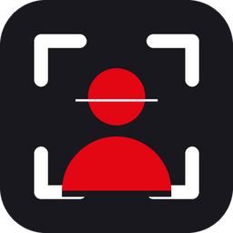
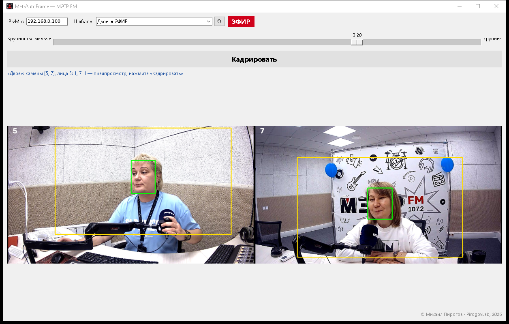
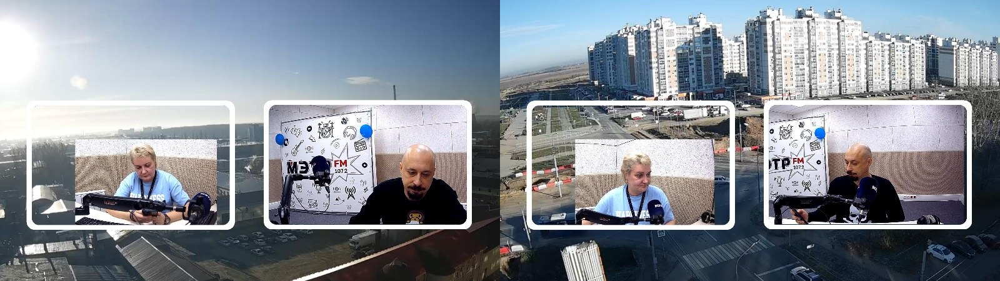
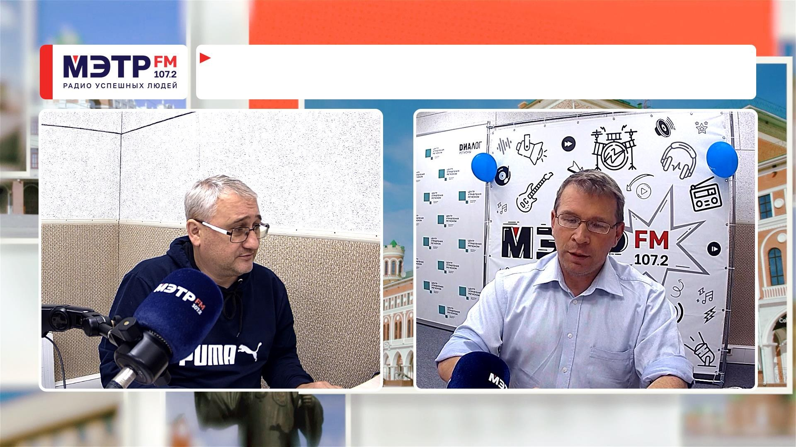

<p align="center"></p>

<h1 align="center">MetrAutoFrame</h1>
<p align="center"><b>Auto-framing of guests in vMix — one button, no PTZ cameras</b><br>
Автокадрирование гостей в vMix — одна кнопка, без PTZ-камер</p>

<p align="center">
<a href="https://github.com/MihailPirogov/metr-autoframe/releases/latest"></a>


</p>

<p align="center"></p>

[Русский](#русский) · [English](#english)

---

## Русский

Сделано для видеостудии радио **МЭТР FM**. В эфире на два–четыре гостя стоят обычные статичные камеры, а в vMix — шаблоны с окнами (картинка-рамка или видео-оформление). Гости садятся как удобно, и каждый раз кто-то крупнее, кто-то ниже, кто-то сбоку. MetrAutoFrame выравнивает их за пару секунд: **одна кнопка «Кадрировать»**.

### Что умеет
- **1–4 гостя** в одном шаблоне vMix; камеры — любые входы (NDI, SRT, VLC, Stream, capture).
- **Детектор лиц YuNet** (OpenCV) — быстро и без GPU.
- Подгоняет только **Zoom / PanX / PanY / Crop** слоёв-камер, чтобы головы были **одного размера, на одной линии глаз и по центру окон**. Preview/Program, цвет и другие входы не трогаются.
- **Окна берутся автоматически**: из прозрачных окон PNG-рамки или из альфа-канала видео-оформления (.mov через ffmpeg). Найденные окна кешируются в `окна.json` — на эфирной машине ни .mov, ни ffmpeg не нужны.
- Ползунок **«Крупность»** — мельче/крупнее, применяется сразу.
- **Отсчёт 3-2-1** перед кадрированием — гости успевают сесть ровно.
- Маркер **● ЭФИР** — видно, какой шаблон сейчас в программе.
- **Предупреждение о краях**: красная полоса в превью — с этой стороны камере не хватает картинки.
- Работает с локальным и удалённым vMix (кадры камер через DP Thumbnail Server).
- Список шаблонов — в простом `шаблоны.txt` **по названию входа** (или по номеру), перечитывается на лету.
- Кнопка **«Отменить»** возвращает слоям прежнее кадрирование.
- История версий — в [CHANGELOG.md](CHANGELOG.md).

<p align="center"><br><i>Слева — исходные широкие планы: лица разного размера и не по центру. Справа — кадрирование MetrAutoFrame.</i></p>
<p align="center"><br><i>Шаблон с видео-оформлением: окна найдены по альфа-каналу</i></p>

### Несколько гостей на одной камере (v1.2.2)

Если одна камера стоит в нескольких окнах шаблона (например, «Трое»: левое окно — одна камера, два правых — другая), программа берёт столько лиц, сколько окон, и ставит каждого человека в окно **со своей стороны кадра**. Одно лицо никогда не дублируется в двух окнах.

Если людей меньше, чем окон, в пустое окно ставится **свободная часть этой же камеры** — то место, где сидел бы второй гость, в том же масштабе и без этого человека в кадре. В статусе: «в окне N пустое место». Если на камере никого нет, окна делят картинку поровну слева направо.

Окна могут быть любой формы, в том числе вертикальные. Рамку можно добавить в vMix как Image или ImageSequence (в имени файла — «рамк», «frame», «okna» или «шаблон»).

Окна ищутся в таком порядке: прозрачные отверстия PNG-рамки → кеш `окна.json` → альфа-канал видео-оформления → геометрия слоёв камер. Перед отправкой в vMix программа проверяет, что окна достаточно большие, читаются, не выходят за кадр и не наезжают друг на друга; иначе кадрирование отменяется.

### Установка и запуск
1. Скачайте `MetrAutoFrame.zip` из [Releases](https://github.com/MihailPirogov/metr-autoframe/releases/latest) и распакуйте. Установка не нужна.
2. В vMix включите **Settings → Web Controller** (порт 8088).
3. Для удалённого vMix поставьте на машину vMix **DP Thumbnail Server** (порт 8098) — через него берутся кадры камер.
4. Впишите свои шаблоны в `шаблоны.txt` (лучше по **названию** входа, номер — запасной вариант):
   ```
   vMix = 192.168.0.100
   Двое в студии = Двое
   Трое в студии = Трое
   Выездной эфир = 10
   ```
   Сначала ищется точное совпадение названия (регистр важен: «Трое» и «трое» — разные входы), затем без учёта регистра, затем номер. Если номер устарел, программа попробует найти вход по имени слева.
5. Запустите `MetrAutoFrame.exe`, выберите шаблон и нажмите **«Кадрировать»**. Метка **● ЭФИР** обновляется сама, раз в две секунды, по тому входу, который сейчас в Program.

В шаблоне нужны слои-камеры и (желательно) картинка рамок с прозрачными окнами — имя входа содержит «шаблон», «рамк», «frame» или «okna». Либо видео-оформление с прозрачными «дырками».

### Сборка из исходников
```bat
python -m venv .venv
.venv\Scripts\pip install -r requirements.txt
.venv\Scripts\python get_model.py
.venv\Scripts\pyinstaller --noconfirm --onefile --windowed --name MetrAutoFrame ^
  --icon MetrAutoFrame.ico --version-file version.txt ^
  --add-data "config.json;." --add-data "face_detection_yunet_2023mar.onnx;." ^
  --add-data "MetrAutoFrame.ico;." app.py
```
Готовый exe — в `dist\`. Положите рядом `examples\шаблоны.txt` и `examples\окна.json`. Запуск без сборки: `python app.py`.

---

## English

Built for the **METR FM** radio video studio. Talk shows with two to four guests use plain static cameras, and vMix holds templates with windows (a PNG frame or an animated alpha overlay). Guests sit wherever they like, so one head ends up bigger, another lower, a third off-center. MetrAutoFrame lines them up in a couple of seconds with **one "Frame" button**.

### Features
- **1–4 guests** per vMix template; cameras can be any input (NDI, SRT, VLC, Stream, capture).
- **YuNet face detection** (OpenCV): fast, no GPU needed.
- Adjusts only **Zoom / PanX / PanY / Crop** of the camera layers so heads are **the same size, on one eye line and centered in their windows**. Preview/Program, color and other inputs are never touched.
- **Windows are found automatically** from the transparent holes of a PNG frame or from the alpha channel of a video overlay (.mov via ffmpeg). Results are cached in `окна.json`, so the on-air PC needs neither the .mov nor ffmpeg.
- **"Крупность" (shot size)** slider: tighter or wider, applied instantly.
- **3-2-1 countdown** before framing, so guests can settle.
- **● ЭФИР (ON AIR)** marker shows which template is in Program.
- **Edge warnings**: a red bar in the preview means the camera has no picture left on that side.
- Works with local and remote vMix (remote camera frames come from DP Thumbnail Server).
- Template list lives in a plain `шаблоны.txt`, preferably **by vMix input title** (a number still works), reloaded on the fly.
- **Undo** restores the previous zoom / pan / crop after a framing.
- See [CHANGELOG.md](CHANGELOG.md) for the version history.

### Several guests on one camera (v1.2.2)

When one camera feeds several windows of a template (e.g. "Three": one camera in the left window, another in the two right-hand ones), the app takes as many faces as there are windows and puts each person in the window **on their side of the frame**. One face is never copied into two windows.

If there are fewer people than windows, the empty window shows the **free part of the same camera** — the seat where the second guest would sit — at the same zoom, with that guest kept out of the crop. The status reads "в окне N пустое место". If the camera has no faces at all, its windows split the picture evenly left to right.

Windows can have any shape, including portrait. The frame PNG may be added to vMix as Image or ImageSequence (file name containing "frame", "okna", "рамк" or "шаблон").

Windows are resolved in this order: transparent holes in the PNG frame → `окна.json` cache → video-overlay alpha channel → camera layer geometry. Before anything is sent to vMix the app checks that the windows are large enough, readable, inside the canvas and not heavily overlapping; otherwise framing is cancelled.

### Install & use
1. Download `MetrAutoFrame.zip` from [Releases](https://github.com/MihailPirogov/metr-autoframe/releases/latest) and unzip. No installer.
2. In vMix enable **Settings → Web Controller** (port 8088).
3. For a remote vMix, run **DP Thumbnail Server** (port 8098) on the vMix machine.
4. List your templates in `шаблоны.txt` (`Display name = vMix input title`, or a number; optional `vMix = <IP>`). Titles are matched exactly first (case matters), then case-insensitively, then by number.
5. Run `MetrAutoFrame.exe`, choose a template, press **«Кадрировать»** (Frame). The **● ЭФИР** (ON AIR) marker follows Program automatically, every two seconds.

### Build from source
See the commands in the Russian section: create a venv, `pip install -r requirements.txt`, `python get_model.py` (downloads YuNet from OpenCV Zoo), then run PyInstaller. Or simply `python app.py`.

---

### Credits
- Face detection: [YuNet](https://github.com/opencv/opencv_zoo/tree/main/models/face_detection_yunet), OpenCV Zoo (MIT).
- Remote thumbnails: DP Thumbnail Server for vMix.

**© 2026 Михаил Пирогов / [PirogovLab](https://pirogovlab.ru)** · MIT License
